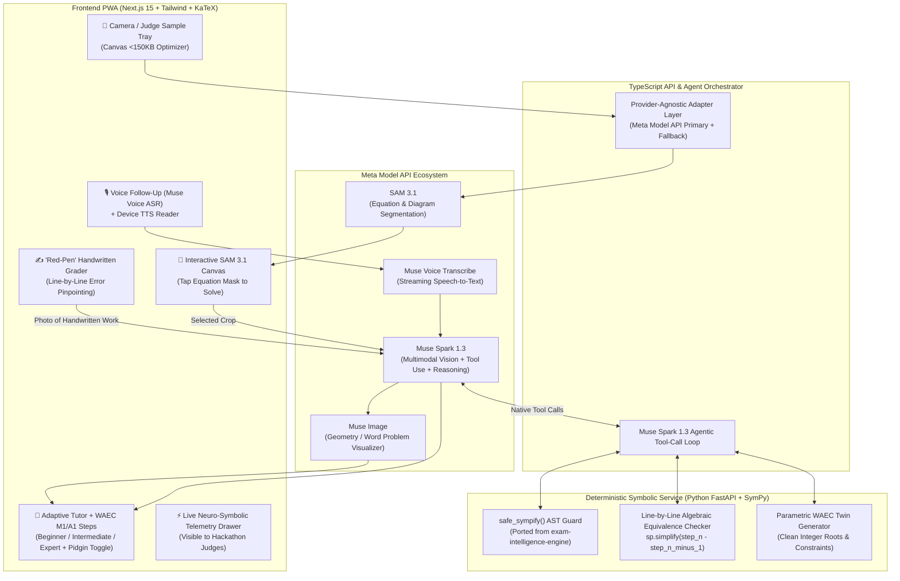

# 🚀 SolvAm: Detailed Phase-by-Phase Execution Plan

> **Hackathon Status:** LIVE (Started Oct 26, 6:00 PM | Deadline: Nov 5, 3:00 AM)  
> **Target Track:** Track 1 (Indie Developer) — *Build for Your World*  
> **Core Thesis:** A Neuro-Symbolic Camera Math Tutor & "Red-Pen" Handwritten Work Grader engineered for Nigerian SSCE/WAEC students.

---

## 🎯 Alignment with the Official Judging Rubric

| Rubric Category | Weight | How SolvAm Engineered a 10/10 Score |
| :--- | :--- | :--- |
| **1. Impact** | **30%** | • Targets the **729,429 annual Nigerian WASSCE math failures**. • Grades using official **WAEC Theory Marking Rubrics (`M1` Method Marks, `A1` Accuracy Marks)**—teaching students how to earn partial credit even if their final number is wrong. • **"Red-Pen" Handwritten Grader:** Students solve practice problems on real paper with a pen, snap a photo, and get line-by-line mistake diagnosis. • Built for real Nigerian constraints: client-side image compression ($<150\text{KB}$ for 3G networks), English + Nigerian Pidgin scaffolding modes. |
| **2. Use of Meta AI Tooling** | **25%** | • Goes far beyond a basic chat wrapper by orchestrating **4 Meta Models** + **Native Agentic Tool Calling**: &nbsp;&nbsp;1. **SAM 3.1:** Segments full textbook/notebook pages into tap-to-select equation masks. &nbsp;&nbsp;2. **Muse Spark 1.3:** Uses test-time reasoning + **native parallel tool-calling** to invoke our deterministic SymPy engine (`sympy_verify_step`, `sympy_generate_twin`). &nbsp;&nbsp;3. **Muse Voice Transcribe:** Real-time voice Q&A for students asking "Why?" on any step. &nbsp;&nbsp;4. **Muse Image:** Generates visual diagrams for geometry, mensuration, and bearing word problems. |
| **3. Demo** | **25%** | • **1-Click "Judge Mode" Sample Bar:** Pre-loaded with authentic WAEC past question pages & messy handwritten student work so judges can test in 1 click without needing physical paper. • **Live Neuro-Symbolic Telemetry Drawer:** Visualizes SAM 3.1 masks, Muse Spark tool calls, and SymPy verification ticks in real time. • Interactive "Red-Pen" canvas overlay highlighting exact lines where a student made a mistake. |
| **4. Technical Depth & Execution** | **20%** | • **Zero-Hallucination Neuro-Symbolic Architecture:** Combines multimodal LLMs with deterministic Python `SymPy` AST verification (ported & upgraded from `exam-intelligence-engine`). • Provider-agnostic adapter pattern (`MetaMuseProvider`, `AnthropicProvider`, `DeepSeekProvider`) with circuit breakers, prefix caching, and regex JSON sanitization. |

---

## 🏗️ System Architecture Overview

---

## 📋 Detailed Phase-by-Phase Build Plan

### Phase 1: Clean Foundation, Monorepo & Deterministic Symbolic Engine (Day 1 — Today)
**Goal:** Establish a rock-solid, type-safe foundation and port the battle-tested `SymPy` math engine so our deterministic tools are ready before touching LLM prompts.
* **Rubric Target:** *Technical Depth & Execution (20%)*
* **Engineering Tasks:**
  1. **Initialize Workspace (`solvam/`):**
     - `apps/web`: Next.js 15 (App Router, TypeScript, Tailwind CSS, Lucide Icons, KaTeX).
     - `services/symbolic-engine`: Lightweight Python FastAPI service wrapping upgraded `math_engine.py` from `exam-intelligence-engine`.
     - `packages/shared-types`: Shared Zod/Pydantic schemas for equations, WAEC rubrics, and telemetry events.
  2. **Upgrade `math_engine.py` for SolvAm:**
     - Endpoint `POST /symbolic/solve`: Accepts a LaTeX or SymPy string, sanitizes via `ALLOWED_SYMPY_NAMES`, returns exact roots, intermediate algebraic milestones (e.g., discriminant $\Delta = b^2 - 4ac$, factored form), and operation type.
     - Endpoint `POST /symbolic/verify-steps`: Accepts a list of student handwritten steps (`["2x^2 + 5x - 3 = 0", "2x^2 + 6x - x - 3 = 0", "(2x - 1)(x + 3) = 0"]`), checks mathematical equivalence between consecutive lines using SymPy, and flags the exact index where equivalence breaks!
     - Endpoint `POST /symbolic/generate-twin`: Uses `randomize_parameters()` to generate a mathematically verified twin problem with clean roots.
* **Phase 1 Deliverable:** Running local monorepo where `POST /symbolic/solve` and `POST /symbolic/verify-steps` pass 100% of unit tests on quadratic, linear, simultaneous, indices, and logarithmic equations.

---

### Phase 2: Model-Agnostic AI Gateway & Neuro-Symbolic Tool Loop (Day 2)
**Goal:** Build the provider-agnostic adapter layer (`MetaMuseProvider`, `ClaudeProvider`, `DeepSeekProvider`) and wire up **Muse Spark 1.3 Native Tool Calling** to our Python Symbolic Engine.
* **Rubric Target:** *Use of Meta AI Tooling (25%) & Technical Depth (20%)*
* **Engineering Tasks:**
  1. **Defensive LLM Client (Ported from `generation.py`):**
     - Implement truncation detection (`finish_reason === 'length'`), markdown fence stripping, regex JSON fallback extraction, and prefix-cached static system prompts.
  2. **Neuro-Symbolic Tool Registration:**
     - Register `solve_equation_deterministically`, `verify_student_step_equivalence`, and `generate_parametric_twin_question` as structured tools in the Meta Model API (`muse-spark-1.3`) request payload.
     - Implement the multi-turn tool-execution loop that captures **Telemetry Events** (tool name, input arguments, SymPy output, execution time in ms) to stream to the frontend Judge Telemetry Drawer.
  3. **Vision Transcription & LaTeX Normalization:**
     - Build `/api/math/transcribe` that accepts a base64 image crop, extracts both printed text and LaTeX formulas, identifies the WAEC syllabus topic (e.g., *Indices, Quadratic Equations, Mensuration, Simultaneous Equations*), and returns a confidence score ($0.0 - 1.0$).
* **Phase 2 Deliverable:** API pipeline that takes a math image, invokes Muse Spark Vision, automatically triggers the SymPy tool call, and returns a 100% verified structured JSON response with telemetry logs.

---

### Phase 3: SAM 3.1 Multi-Problem Page Segmentation & Camera UX (Days 3–4)
**Goal:** Build the "Shazam for Math" camera experience using **SAM 3.1** so students can snap an entire page of equations and tap the exact one they want to solve, plus a KaTeX confirmation gate.
* **Rubric Target:** *Use of Meta AI Tooling (25%) & Demo (25%)*
* **Engineering Tasks:**
  1. **Client-Side Image Optimizer:**
     - HTML5 `<canvas>` preprocessor that downscales raw 12MP phone photos to max $1600\times1600\text{px}$ JPEG ($<150\text{KB}$) in $<50\text{ms}$.
  2. **SAM 3.1 Segmentation Pipeline (`/api/math/segment`):**
     - Sends the full-page photo to **SAM 3.1** (`prompt: "mathematical equation, algebraic expression, word problem, geometric figure"`).
     - Renders interactive SVG bounding boxes and glowing segmentation masks over the image on the client.
     - Includes a manual crop box fallback if the user wants to adjust the region.
  3. **Port `MathText.tsx` & Verification Modal:**
     - Port the mixed prose + LaTeX tokenizer from `exam-intelligence-engine` using KaTeX.
     - Before solving, show the student the rendered equation: *"We read: $2x^2 + 5x - 3 = 0$. Correct?"* with one-tap confirm or quick edit.
* **Phase 3 Deliverable:** Working visual capture flow: snap full page $\rightarrow$ tap glowing SAM 3.1 mask $\rightarrow$ verify KaTeX formula.

---

### Phase 4: WAEC-Aligned Adaptive Pedagogy, Pidgin Mode & Multimodal Audio/Visuals (Days 5–6)
**Goal:** Build the adaptive teaching interface that explains *how* to solve the problem at the student's chosen scaffolding level, annotated with WAEC `M1/A1` marks, voice Q&A, and generated visual diagrams.
* **Rubric Target:** *Impact (30%) & Use of Meta AI Tooling (25%)*
* **Engineering Tasks:**
  1. **3-Tier Pedagogical Scaffolding + Nigerian Context:**
     - **🟢 Beginner ("Foundation Mode"):** Breaks down every micro-step using relatable Nigerian analogies (e.g., market pricing in Naira ₦, sharing items), zero skipped arithmetic, and optional **Nigerian Pidgin / Standard English toggle**.
     - **🟡 Intermediate ("SSCE Prep Mode"):** Standard WAEC Theory layout showing explicit **`[M1]` Method Marks** and **`[A1]` Accuracy Marks** so students learn what examiners grade.
     - **🔴 Expert ("Distinction / A1 Mode"):** Socratic hints only; challenges the student to find the next step before revealing it.
  2. **Multimodal Concept Visualizer (Muse Image):**
     - When the topic involves geometry, trigonometry, bearing, or mensuration, trigger **Muse Image** to generate a clean illustrative diagram alongside the steps.
  3. **Bidirectional Voice Tutor (Muse Voice Transcribe + TTS):**
     - **Output (TTS):** Step-by-step audio reader with math-to-speech normalization (reads `x^2` as *"x squared"*, `\frac{a}{b}` as *"a over b"*) and $0.8\times / 1.0\times / 1.2\times$ speed controls.
     - **Input (Muse Voice Transcribe):** Hold-to-talk mic button on any step. Streams audio to **Muse Voice Transcribe**, allowing the student to ask a question aloud and get an instant contextual clarification.
* **Phase 4 Deliverable:** Complete interactive teaching experience with WAEC rubric badges, voice interaction, and visual diagram generation.

---

### Phase 5: The Killer Feature — "Red-Pen" Handwritten Work Grader & Practice Loop (Days 7–8)
**Goal:** Close the pedagogical loop. After learning, the student gets a twin practice problem, writes their solution on paper, snaps a photo of their handwritten work, and gets a line-by-line "Red-Pen" diagnostic grade.
* **Rubric Target:** *Impact (30%), Technical Depth (20%), Demo (25%)*
* **Engineering Tasks:**
  1. **Instant Twin Problem Generation:**
     - One click on *"Test Me on This"* calls our SymPy parametric generator (`generate-twin`) to create a fresh WAEC-style question of identical structure.
  2. **Handwritten Multi-Line Work Scanner (`/api/math/grade-handwriting`):**
     - Student snaps a photo of their handwritten notebook solution (or types their answer if preferred).
     - **Muse Spark 1.3 Vision + SAM 3.1** extracts each line of the student's handwritten working along with its vertical bounding box `[y_min, x_min, y_max, x_max]`.
     - **SymPy Step Verifier** checks mathematical equivalence from Line 1 to Line $N$.
  3. **"Red-Pen" Visual Canvas Overlay:**
     - Renders green checkmarks (`✅ M1 Earned`) next to mathematically valid lines on the student's photo.
     - Draws a glowing **red diagnostic box (`❌ Sign Error Here`)** on the exact line where equivalence broke, explaining *why* (e.g., *"On Line 3, you wrote $-6 + 1 = -7$ instead of $-5$. You still earned 2/4 Method Marks (M1, M1)!"*).
* **Phase 5 Deliverable:** End-to-end "Learn $\rightarrow$ Practice on Paper $\rightarrow$ Snap Handwritten Work $\rightarrow$ Red-Pen WAEC Grade" loop.

---

### Phase 6: "Judge Mode", Live Neuro-Symbolic Telemetry & PWA Polish (Day 9)
**Goal:** Engineer the application specifically for how hackathon judges evaluate submissions in a 2-minute window.
* **Rubric Target:** *Demo (25%) & Technical Depth (20%)*
* **Engineering Tasks:**
  1. **1-Click "Judge Mode" Sample Bar:**
     - A prominent top bar on the landing screen: *"⚡ Judging SolvAm? Try 1-Click Live Samples"* featuring:
       - **Sample 1 (Multi-Equation Exam Sheet):** Demonstrates **SAM 3.1** isolating 4 problems on a real WAEC paper.
       - **Sample 2 (Word Problem + Geometry):** Demonstrates **Muse Spark + SymPy + Muse Image** diagram generation.
       - **Sample 3 (Flawed Handwritten Student Solution):** Demonstrates the **"Red-Pen" Handwritten Grader** finding a sign mistake on Line 3 and awarding partial WAEC `M1/A1` marks.
  2. **Live Neuro-Symbolic Telemetry Drawer:**
     - A sleek developer HUD toggleable in the corner that shows judges:
       - Active Meta Model API endpoints called (`SAM 3.1`, `Muse Spark 1.3`, `Muse Voice`, `Muse Image`).
       - Native Tool Call payloads & deterministic `SymPy` verification proofs.
       - Token savings from prefix caching and latency breakdown.
  3. **Production Resilience & Caching:**
     - Pre-warm and cache fallback responses for the 3 Judge Mode samples so even if an API rate limit spikes during judging, the demo never fails.
* **Phase 6 Deliverable:** Deployed production URL on Vercel + Railway/Modal with zero-latency Judge Mode and full telemetry visibility.

---

### Phase 7: Stage-Three Video Production & Submission Package (Day 10 — Nov 4)
**Goal:** Produce a Stage-Three-worthy demo video and documentation package before the Nov 5, 3:00 AM cutoff.
* **Rubric Target:** *Demo (25%) & Impact (30%)*
* **Video Script (2 Minutes 15 Seconds Strict):**
  - **0:00 – 0:25 (The Hook & Impact):** Personal story + the 729,429 WASSCE failure statistic. Show a real physical notebook and WAEC past question paper.
  - **0:25 – 1:05 (Live Shazam for Math):** Point phone at the exam page $\rightarrow$ SAM 3.1 masks light up $\rightarrow$ tap equation $\rightarrow$ Muse Spark calls SymPy tool $\rightarrow$ adaptive breakdown with WAEC `M1/A1` badges + Pidgin voice explanation.
  - **1:05 – 1:45 (The Red-Pen Killer Moment):** Solve the generated twin problem on paper with a deliberate mistake on line 3 $\rightarrow$ snap photo $\rightarrow$ watch SolvAm draw the green `M1` ticks and the red diagnostic box on line 3 with encouraging feedback.
  - **1:45 – 2:15 (Architecture & Meta Stack):** Open the Live Telemetry HUD showing SAM 3.1, Muse Spark 1.3 tool-calling, SymPy AST verification, Muse Voice, and Muse Image working in harmony.
