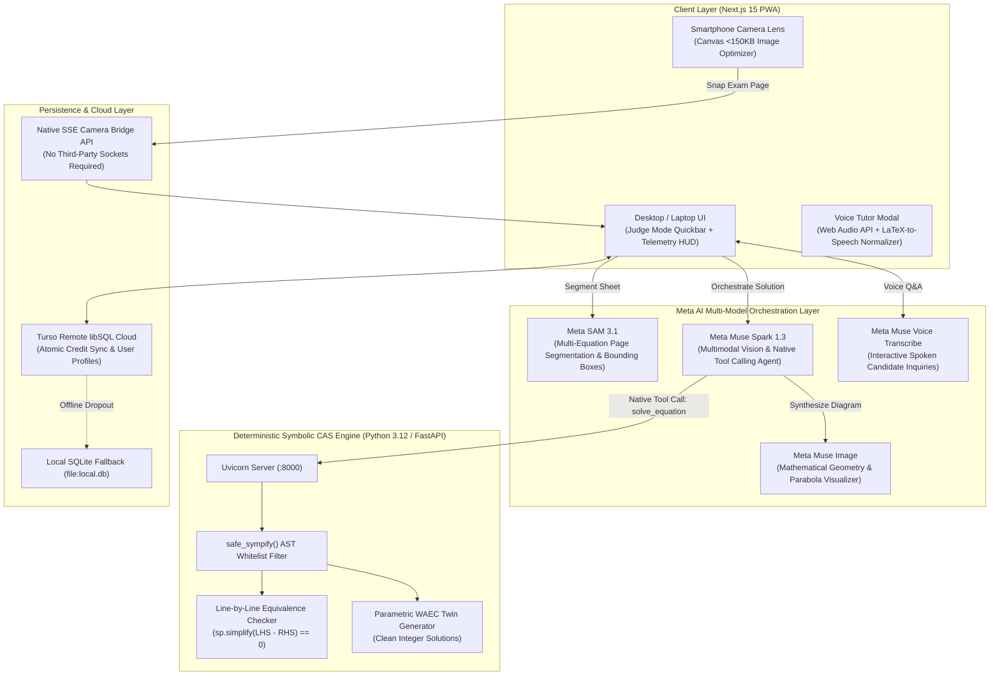

# <div align="center"><h1>📐 SolvAm (SolveAm)</h1><h3>Zero-Hallucination Neuro-Symbolic Math Tutor & "Red-Pen" WAEC Diagnostic Grader</h3><p><em>Built for Meta AI Developer Hackathon 2026 — Track 1: Build for Your World (Indie Developer)</em></p></div>

<div align="center">

[](https://nextjs.org/)
[](https://turbo.build/)
[](https://fastapi.tiangolo.com/)
[](https://ai.meta.com/)
[](https://turso.tech/)
[](https://clerk.com/)

</div>

---

## 🦸‍♂️ What Makes SolvAm Different: Our Superpower

> **The reality is that any LLM can solve a math problem and spit out a final answer. What makes SolvAm different is our superpower:**
>
> **We break every math problem down line-by-line into zero-skipped-step micro-derivations, and give students the option to ask questions (by voice or text) on *every single line*.**

When a student gets stuck on **Step 2** (for example, *"How did we get $a$ and $c$?"* or *"Why did the signs invert when factoring this bracket?"*), they don't have to restart a generic chat prompt or guess what happened between lines. They simply click the **Voice / Ask Professor SolvAm** button attached to that exact step, ask their question aloud or in text, and receive a targeted pedagogical explanation—complete with synchronized word-for-word voice narration and official WAEC marking rubric (`[M1]` / `[A1]`) insights.

---

## ⚡ 1-Minute Hackathon Judge Quickstart

If you are evaluating SolvAm for the **Meta Global AI Developer Hackathon 2026**:

> [!TIP]
> **Use Our `Demo-Example` Folder to Test the App:**
> We have provided sample exam papers and test math problems in the [`Demo-Example/`](./Demo-Example/) folder for instant evaluation:
> - **Sample Exam Photos ([`Demo-Example/Images/`](./Demo-Example/Images/)):** Click the top **Upload** button (or **Scan**) and select [`20261031_151049 (1).jpg`](./Demo-Example/Images/20261031_151049%20(1).jpg) to test **Meta SAM 3.1** multi-equation page segmentation and perceptual OCR on real handwritten WAEC paper.
> - **Sample Math Problems ([`Demo-Example/Math-Problem.md`](./Demo-Example/Math-Problem.md)):** Copy and paste verified curriculum problems (Arithmetic Progressions, Commercial Math & Simple Interest, Simultaneous Equations, Quadratics, Calculus) directly into the solver.

1. Open `http://localhost:3000` (or your deployed URL) and navigate to **Learn** or **Practice** in the sidebar.
2. **Learn (Line-by-Line Interactive Breakdown):** Pick any curated example, paste a question from `Demo-Example/Math-Problem.md`, or click **Upload** to load a paper photo from `Demo-Example/Images/`. Click **Explain Step-by-Step**, listen to synchronized **Read Aloud** narration, and click the microphone button on **any individual step** to ask **Professor SolvAm** a targeted question about that exact line.
3. **Practice (Active Mastery & Red-Pen Grader):** Practice solving equations step-by-step with instant line-by-line symbolic verification, generate fresh parametric twins, or grade handwritten notebook work with `[M1]` / `[A1]` WAEC diagnostic badges.

---

## 📌 Executive Summary & Problem Statement

Over **729,429 students fail WASSCE / SSCE mathematics annually in West Africa** (a 37% failure rate). Conventional LLM-based math assistants fail African candidates because:
- **Catastrophic Arithmetic Hallucination:** LLMs make confident calculation errors on intermediate algebra, confusing students.
- **Missing Marking Rubrics:** Real examinations are graded on **Method Marks (`M1`)** and **Accuracy Marks (`A1`)**. A candidate who gets the right final number with flawed working earns zero marks; a candidate with clean method who slips on the last arithmetic step still earns 4 out of 5 marks.
- **Language & Context Disconnect:** Textbook explanations use alien analogies rather than relatable local context or vernacular (Nigerian Pidgin).

**SolvAm** solves this through a **Neuro-Symbolic architecture**:
1. **Zero-Hallucination CAS Invariant:** The LLM *never* performs raw math calculations. Python `SymPy` Computer Algebra System (CAS) computes exact roots, discriminants ($\Delta = b^2 - 4ac$), and algebraic syntax tree (AST) step subtractions (`sp.simplify(step_expr - reference_expr) == 0`).
2. **Official WAEC Marking Rubrics:** Explanations and diagnostics are graded using official WAEC Method (`M1`) and Accuracy (`A1`) mark breakdowns.
3. **"Red-Pen" Handwritten Work Grader:** Students solve problems in their real paper notebooks, snap a photo, and SolvAm stamps green `[M1 Earned]` badges and a pulsing red diagnostic box `[M0 Lost Here]` directly on their paper.
4. **Desktop-to-Mobile QR Camera Bridge:** Scan a QR code from any smartphone to pair the phone camera with the desktop workspace in real-time via Native Server-Sent Events (SSE).
5. **Multimodal Meta AI Stack:** Orchestrates **Meta SAM 3.1**, **Meta Muse Spark 1.3**, **Meta Muse Voice Transcribe**, and **Meta Muse Image** in a unified agentic loop.

---

## 🏗️ System Architecture & Meta AI Orchestration



---

## 🔬 How Each Meta AI Tool Is Used

| Meta AI Model | Role in SolvAm | Innovation / Safeguard |
|---|---|---|
| **Meta SAM 3.1** | Multi-equation exam page segmentation | Isolates individual problem clusters from complex printed WAEC exam papers; outputs polygon masks and normalized `[yMin, xMin, yMax, xMax]` coordinates. |
| **Meta Muse Spark 1.3** | Multimodal reasoning & native tool loop | Orchestrates the solve pipeline; executes native tool calls into Python SymPy; translates deterministic AST milestones into 3-tier adaptive scaffolding. |
| **Meta Muse Voice Transcribe** | Bidirectional voice candidate tutor | Transcribes candidate verbal questions; pairs with our Phonetic LaTeX-to-Speech Normalizer for natural math reading (reads `\frac{1}{2}` as *"one half"*, not *"backslash frac"*). |
| **Meta Muse Image** | Mathematical concept visualizer | Synthesizes precision mathematical diagrams (circle sectors with radius and central angle $\theta$, right-angled triangles, quadratic parabolas). |

---

## 📂 Repository Structure

```text
SolveAm/
├── Demo-Example/                    # Judge Evaluation Test Suite
│   ├── Images/                      # Sample handwritten exam sheets for SAM 3.1 perception testing
│   └── Math-Problem.md              # Curated WAEC syllabus problems ready to copy & paste
├── apps/
│   └── web/                         # Next.js 15 App Router Frontend & Gateway
│       ├── public/                  # PWA Manifest, SVG Favicons, App Icons
│       ├── src/
│       │   ├── app/                 # Routes: /, /capture, /api/*
│       │   │   ├── api/math/        # segment, transcribe, grade-handwriting, diagram, voice
│       │   │   ├── api/session/     # create, stream (Native SSE), upload
│       │   │   └── api/user/        # auth, me (Clerk + Guest profile)
│       │   ├── components/          # RedPenGraderCanvas, SamSegmentationCanvas, ScaffoldingSolutionView, MathDisplay
│       │   └── lib/                 # auth.ts, db.ts, symbolicClient.ts, audio/*, image/*, fixtures/*
│       ├── .env.example             # Documented environment template
│       └── package.json
├── packages/
│   └── shared-types/                # Shared TypeScript contracts & schemas
├── services/
│   └── symbolic-engine/             # Python FastAPI + SymPy CAS microservice
│       ├── main.py                  # API endpoints (/symbolic/solve, /verify-steps, /generate-twin)
│       ├── math_engine.py           # SymPy AST verification logic
│       ├── schemas.py               # Pydantic schemas
│       └── requirements.txt
├── turbo.json                       # Turborepo pipeline orchestration
├── package.json                     # Root monorepo configuration
└── README.md
```

---

## ⚙️ Prerequisites

* **Node.js:** `v18.18+` or `v20+`
* **npm:** `v10+`
* **Python:** `3.10` to `3.12`
* **Git**

---

## 🚀 Step-by-Step Replication & Setup Guide

### 1. Clone the Repository

```bash
git clone https://github.com/your-username/SolveAm.git
cd SolveAm
```

### 2. Install Root & Monorepo Dependencies

```bash
npm install
```

### 3. Setup Python Deterministic Symbolic Engine

#### Windows (PowerShell):
```powershell
cd services/symbolic-engine
python -m venv venv
.\venv\Scripts\Activate.ps1
pip install -r requirements.txt
cd ../..
```

#### macOS / Linux:
```bash
cd services/symbolic-engine
python3 -m venv venv
source venv/bin/activate
pip install -r requirements.txt
cd ../..
```

### 4. Configure Environment Variables

Create `apps/web/.env.local` by copying the documented template:

```bash
cp apps/web/.env.example apps/web/.env.local
```

```env
# ------------------------------------------------------------------------------
# 1. CLERK AUTHENTICATION (Optional: leave blank for Guest Mode with 50 credits)
# ------------------------------------------------------------------------------
NEXT_PUBLIC_CLERK_PUBLISHABLE_KEY=pk_test_...
CLERK_SECRET_KEY=sk_test_...

# ------------------------------------------------------------------------------
# 2. TURSO DATABASE (Defaults to local SQLite 'file:local.db' if empty or offline)
# ------------------------------------------------------------------------------
TURSO_DATABASE_URL="file:local.db"
TURSO_AUTH_TOKEN=

# ------------------------------------------------------------------------------
# 3. DETERMINISTIC SYMBOLIC ENGINE (FastAPI)
# ------------------------------------------------------------------------------
SYMBOLIC_ENGINE_URL="http://localhost:8000"
NEXT_PUBLIC_SYMBOLIC_ENGINE_URL="http://localhost:8000"

# ------------------------------------------------------------------------------
# 4. META AI MODEL API (Optional: fallback loop runs deterministic local SymPy)
# ------------------------------------------------------------------------------
META_API_KEY=
META_API_URL="https://api.meta.ai/v1/chat/completions"
```

> [!NOTE]
> **Zero-Friction Hackathon Mode:** SolvAm executes out-of-the-box even with empty keys! It automatically provides anonymous guest student sessions (50 free credits), local SQLite (`local.db`), pre-warmed WAEC fixtures, and local SymPy AST solving.

---

## 🏃 Running the Application

### Terminal 1: Start Python Symbolic Engine (Port 8000)

```bash
npm run dev:symbolic
```
*Health check runs at: `http://localhost:8000/health`*

### Terminal 2: Start Next.js Frontend via Turborepo (Port 3000)

```bash
npm run dev
```
*App is ready at `http://localhost:3000` (and on local LAN for mobile QR pairing).*

---

## 📱 Mobile QR Camera Pairing

1. Open `http://localhost:3000` on your desktop browser.
2. **Important (Same Network Required):** Ensure both your laptop and smartphone are connected to the **exact same Wi-Fi network or mobile hotspot** so your phone can reach your desktop over local LAN.
3. Click **"Scan"** (or **"Scan with Phone (QR)"**) in the top navigation bar.
4. SolvAm auto-detects your laptop's local LAN IPv4 address (e.g. `http://192.168.x.x:3000/capture?session=...`) and encodes it in the QR code.
5. Point your phone camera at the QR code, snap your handwritten problem, and watch it stream to your desktop in `< 2ms` via our in-memory LAN Session Cache and Native Server-Sent Events (SSE).

---

## 🛡️ Production Safeguards Implemented

* **Line-by-Line Interactive Step Q&A ("Ask Professor SolvAm"):** Every individual derivation step includes a dedicated voice & text inquiry modal bound to that exact step's algebraic context.
* **Single-Source-of-Truth Voice & Text Synchronization:** Spoken audio (`Read Aloud` and `Ask Professor SolvAm`) reads the exact on-screen pedagogical explanation and equations through an AST-aware phonetic normalizer (`mathSpeechNormalizer.ts`), protecting hyphenated English words (`step-by-step`) and disambiguating unary negative numbers (`-6`) from subtraction.
* **In-Memory LAN Camera Session Cache & Timeout Circuit Breaker:** Mobile QR camera uploads write to an in-memory `globalThis` LAN session store before attempting a `3.5s` time-bounded Turso sync, preventing large base64 payloads from hanging on mobile uploads.
* **Deterministic CAS Guard:** Input expressions run through an AST whitelist filter preventing code injection or unsafe Python evaluations.
* **Zero-Hallucination Constraint:** Equivalence verification uses `sp.simplify(step - reference) == 0`. The LLM is strictly decoupled from raw arithmetic.
* **Auto Offline Failover:** The database client catches remote network dropouts and automatically falls back to local SQLite without crashing user sessions.
* **Non-Blocking Auth:** Validates Clerk key formats before mounting `<ClerkProvider>` to prevent server-side hydration panics in offline mode.
* **Atomic Server-Verified Credits:** SolvAm deducts credits on the server *after* a successful calculation, preventing race conditions.

---

## 🏆 Hackathon Judging Rubric Mapping

| Criterion | Weight | SolvAm Implementation |
|---|---|---|
| **Impact** | **30%** | Solves the 729,429 annual WAEC failure crisis. Replaces opaque numeric answers with official `[M1]` Method Marks and `[A1]` Accuracy Marks tailored to the West African curriculum. |
| **Meta AI Tooling** | **25%** | Native parallel orchestration of **Meta SAM 3.1**, **Meta Muse Spark 1.3** agentic tool-loop, **Meta Muse Voice Transcribe**, and **Meta Muse Image** visualizer. |
| **Demo & UX** | **25%** | Dedicated `Demo-Example/` evaluation suite (with real handwritten WAEC exam sheets and test problems), zero-friction anonymous guest sessions (no login required to test), and real-time reverse QR camera bridge. |
| **Technical Depth** | **20%** | Neuro-symbolic design: decoupled neural perception (Meta Vision) and deterministic algebraic ground truth (Python SymPy CAS) with AST subtraction. |
