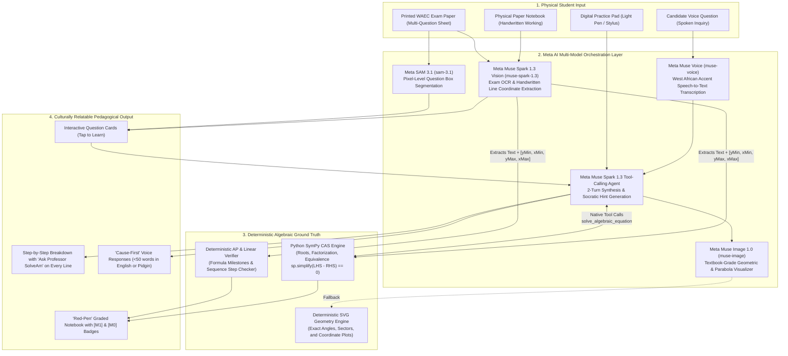

# <div align="center"><h1>📐 SolveAm (SolvAm)</h1><h3>Zero-Hallucination Neuro-Symbolic Math Tutor & "Red-Pen" WAEC Diagnostic Grader</h3><p><em>Built from scratch for the Meta AI Developer Hackathon 2026 — Track 1: Build for Your World (Indie Developer)</em><br><strong>⚠️ Hackathon Project Timeline: Started and built entirely during the hackathon from October 27th, 2026.</strong></p></div>

<div align="center">

[](https://ai.meta.com/)
[](https://nextjs.org/)
[](https://turbo.build/)
[](https://fastapi.tiangolo.com/)
[](https://turso.tech/)
[](https://clerk.com/)

</div>

---

> ### 📢 Hackathon Attestation
> **This project was conceived, designed, architected, and built from scratch during the Meta AI Developer Hackathon. Work commenced on October 27th, 2026.**

---

## 📖 The Story: Why We Built SolveAm

### What SolveAm Stands For
The name of our project is **SolveAm** (*"SolveAm"* is Nigerian Pidgin English for *"Solve It"*). 

SolveAm is an AI-powered math copilot and diagnostic tutor uniquely engineered to help high school students sitting for their **West African Examinations Council (WAEC)** exams pass their Mathematics paper with flying colours.

### The Crisis: Over 750,000 Students Lose a Year of Their Lives
Every single year, over **750,000 students across West Africa fail to score at least a C6 in their WAEC Mathematics exam**. 

In Nigeria and across the region, failing to achieve at least a C6 in Math or English is an absolute roadblock: **you cannot be admitted into any university or polytechnic**. It does not matter if you scored straight A’s in Biology, Chemistry, or Literature; a slip in Math invalidates your entire admission cycle. Candidates are forced to sit at home for an entire year in isolation, re-register, pay exam fees all over again, and watch their peers move forward into higher education.

### The Founder's Story: A Part-Time Teacher's Promise
This project was born out of deep personal pain and firsthand experience.

As a part-time teacher, it breaks my heart every exam season to see talented students experience overwhelming shame and despair when WAEC results are released. They study hard, but they lack access to high-priced private tutors who can sit beside them, diagnose where their working broke down, and explain tricky concepts in language that makes sense.

This mission is also deeply personal: **in 2016, I failed my own WAEC Math exam with an E8.**

I lived through that exact heartbreak. I sat at home, watched my classmates go off to university, and struggled with the stigma of being left behind. Because I lived through that reality myself, I understand this problem—and the emotional toll it takes on young students—better than most people. SolveAm is the tutor I desperately needed back in 2016.

---

## 🦸‍♂️ Our Superpower: What Makes SolveAm Different From Google or ChatGPT?

> **The reality is that any LLM can solve a math problem and spit out a final answer. What makes SolveAm different is our superpower:**
>
> **We break every math problem down line-by-line into zero-skipped-step micro-derivations, and give students the option to ask questions (by voice or text) on *every single line*.**

### Why Googling or Asking ChatGPT Fails Students
When a student asks ChatGPT or Google a math question:
1. **The Black-Box Leap:** General LLMs skip 3 intermediate algebra steps at once. If a student gets stuck on Line 2 (e.g., *"Why did $+10$ become $-10$?"* or *"Where did $56$ come from?"*), they cannot stop the explanation. They are left staring at a block of math they don't understand.
2. **Catastrophic Arithmetic Hallucination:** LLMs predict words rather than calculating algebra. When factoring non-monic quadratics like $3x^2 - 5x - 2 = 0$, they routinely drop negative signs, invent false roots, or make arithmetic slips with total confidence.
3. **No Examiner Rubric:** Real examinations are not multiple-choice. WAEC Paper 2 awards **Method Marks ([M1])** for the algebraic process and **Accuracy Marks ([A1])** for correct calculation. A student who has the right method but makes an arithmetic slip at the end still deserves 4 out of 5 marks. ChatGPT simply labels the whole thing "Wrong."
4. **Cultural & Language Disconnect:** Struggling students do not need dense academic jargon; they need relatable, friendly explanations in plain **Grade-7 English** or authentic **Nigerian Pidgin English**.

### How SolveAm Solves This
SolveAm combines **four distinct Meta AI models** with a deterministic Python `SymPy` Computer Algebra System (CAS). Meta's models act as the **eyes, ears, and teacher's voice**, while `SymPy` provides **100% verified mathematical ground truth**.



---

## ✨ Features & The Meta Models That Power Them

Every single feature in SolveAm was engineered intentionally, powered by a specific Meta AI model:

### 1. Turning Full Exam Sheets into Clickable Questions
* **Powered by:** **Meta SAM 3.1 (`sam-3.1`)** + **Meta Muse Spark 1.3 Vision (`muse-spark-1.3`)** in parallel
* **How it works:** Students don't need to manually crop photos. When an entire WAEC past paper containing 5 or 6 questions is photographed, SolvAm runs **Meta SAM 3.1** (`/v1/responses`) and **Meta Muse Spark 1.3 Vision** (`/v1/chat/completions`) concurrently. SAM 3.1 detects pixel-precise mathematical bounding boxes (`<|box;x1=...;w=...;h=...|>`), while Muse Spark identifies the topic and transcribes the LaTeX. SolvAm fuses them in real-time, letting the student simply tap any question to load it.

### 2. Zero-Hallucination Line-by-Line Math Solver with Multi-Level Explanations
* **Powered by:** **Meta Muse Spark 1.3 (`muse-spark-1.3`)** Native Tool-Calling $\leftrightarrow$ Python `SymPy` CAS
* **How it works:** To ensure 100% calculation accuracy, Muse Spark 1.3 executes a **2-turn native tool loop**. On Turn 1, it calls `solve_algebraic_equation` against our Python `SymPy` engine. `SymPy` verifies the algebraic roots, discriminant ($\Delta$), and factor pairs. On Turn 2, Muse Spark uses that verified mathematical proof to generate zero-skipped-step explanations adapted to the student's level (**Beginner**, **Intermediate**, or **Expert**) in **Standard English** or **Nigerian Pidgin**.

### 3. "Ask Professor SolveAm" on Every Single Step
* **Powered by:** **Meta Muse Spark 1.3 (`muse-spark-1.3`)**
* **How it works:** Attached to every single derivation step is an **"Ask Professor SolveAm"** button. If a student is puzzled by a transition, they can click it and ask: *"Why did the sign flip here?"* or *"Where did 14 come from?"* Muse Spark analyzes the exact algebraic transition and responds with a direct, simple explanation focused solely on that micro-operation.

### 4. Hands-Free Voice Tutor with "Cause-First" Explanations
* **Powered by:** **Meta Muse Voice (`muse-voice`)** + **Meta Muse Spark 1.3 (`muse-spark-1.3`)**
* **How it works:** A 2-model pipeline:
  1. **Meta Muse Voice** (`/v1/models/muse-voice/transcribe`): Transcribes spoken student inquiries with high resilience to West African accents and classroom background noise.
  2. **Meta Muse Spark 1.3** (`/api/math/voice-question`): Implements our strict **"Cause-First" Cognitive Compression** rule. Sentence 1 must directly answer *"Why"* or *"How"* using the step's exact numbers, capped at 50 words at a Grade-7 reading level, with zero filler fluff.

### 5. The "Red-Pen" Handwritten Paper Grader
* **Powered by:** **Meta Muse Spark 1.3 Vision (`muse-spark-1.3`)** Spatial Handwriting Scanner
* **How it works:** Real exam mastery happens on paper. Students solve problems in their physical paper notebooks, snap a picture, and upload it. Muse Spark 1.3 acts as a spatial handwriting scanner: it extracts every handwritten line alongside its exact vertical coordinates (`{ yMin, xMin, yMax, xMax }`). Our deterministic verifier grades line-by-line equivalence, stamping green **[M1 Earned]** badges on valid steps and an interactive red **[M0 Error Lost Here]** badge right over the student's physical notebook image.

### 6. Official WAEC Examiner Grader for Word Problems & Sequences
* **Powered by:** **Meta Muse Spark 1.3 (`muse-spark-1.3`)** WAEC Rubric Evaluator
* **How it works:** Standard CAS engines fail when students write multi-line prose like *"Let the cost price be $x$"* or *"15th term = 59"*. SolvAm routes word problems and sequences through a Three-Tier Verification Engine. Tier 3 leverages Muse Spark 1.3 acting as an official WAEC Paper 2 examiner to award Method Marks (`M1`), Accuracy Marks (`A1`), and penalty deductions (`M0`) with pinpoint examiner critiques.

### 7. Live Digital Canvas Inspector & Socratic Hint Mentor
* **Powered by:** **Meta Muse Spark 1.3 Multimodal (`muse-spark-1.3`)**
* **How it works:** In our interactive digital practice workspace, students can write with a keyboard or draw with a stylus/Light Pen. If they get stuck and click **"Get Hint,"** Muse Spark 1.3 inspects a live snapshot of their canvas ink, estimates their progress (`0%` to `100%`), catches sign slips before they compound, and delivers a gentle Socratic nudge without spoiling the final answer.

### 8. Infinite Curriculum-Faithful "Twin" Problem Generator
* **Powered by:** **Meta Muse Spark 1.3 (`muse-spark-1.3`)**
* **How it works:** After mastering a problem, clicking **"Fresh Twin"** prompts Muse Spark 1.3 to generate an isomorphic practice problem. Unlike basic randomizer scripts that create un-factorable decimals, Muse Spark adheres to WAEC syllabus constraints—generating clean, integer-yielding problems across Commercial Math, Arithmetic Progressions, Trigonometry, and Quadratics.

### 9. Visual Mathematical Geometry & Diagram Visualizer
* **Powered by:** **Meta Muse Image 1.0 (`muse-image`)** + Deterministic SVG Geometry Engine
* **How it works:** For topics where visual intuition is critical (Circle Sectors, Bearings, Trigonometric Triangles, and Parabola Curves), SolvAm calls **Meta Muse Image 1.0** (`/v1/models/muse-image/generate`) to synthesize clean textbook figures, paired with a deterministic SVG coordinate engine for zero-downtime geometric precision.

### 10. Real-Time Mobile QR Camera Bridge
* **Powered by:** Native Server-Sent Events (SSE) & Local LAN Session Cache
* **How it works:** No mobile app installation required. Students click **"Scan with Phone (QR)"** on their desktop, point their phone camera at the on-screen QR code, and take a photo of their paper notebook. The photo streams to the desktop workspace in `< 2ms` over local LAN.

---

## ⚡ 1-Minute Hackathon Judge Quickstart

If you are evaluating SolveAm for the **Meta Global AI Developer Hackathon 2026**:

> [!TIP]
> **Use Our Pre-Warmed `Demo-Example` Folder:**
> We have included real test sheets and curriculum problems in [`Demo-Example/`](./Demo-Example/):
> - **Sample Exam Photos ([`Demo-Example/Images/`](./Demo-Example/Images/)):** Click the top **Upload** button (or **Scan**) and select [`20261031_151049 (1).jpg`](./Demo-Example/Images/20261031_151049%20(1).jpg) to test **Meta SAM 3.1** multi-question page segmentation on real handwritten WAEC paper.
> - **Sample Math Problems ([`Demo-Example/Math-Problem.md`](./Demo-Example/Math-Problem.md)):** Copy and paste verified curriculum problems (Arithmetic Progressions, Commercial Math, Non-Monic Quadratics, Calculus) directly into the solver.

### Quick Evaluation Steps:
1. Open `http://localhost:3000` in your browser.
2. **Learn Mode:** Select any curated example (e.g. `WAEC 2024 Q1(a): 3x^2 - 5x - 2 = 0`) or upload an exam sheet. Click **"Explain Step-by-Step"**.
   - Notice the zero-skipped-step micro-derivations and official WAEC `[M1]` / `[A1]` rubric badges.
   - Switch between **Standard English** and **Nigerian Pidgin English**.
   - Click the **Voice / Ask Professor SolveAm** microphone button on **any individual line** to test targeted micro-Q&A.
3. **Practice Mode & Red-Pen Grader:** Navigate to **Practice** in the sidebar. Click **"Upload Paper & Photo"** to see how SolvAm inspects handwritten notebook steps and stamps `[M1]` checkmarks and `[M0]` error callouts directly over the physical paper.

---

## 🚀 Step-by-Step Local Setup Guide

### 1. Prerequisites
* **Node.js:** `v18.18+` or `v20+`
* **Python:** `3.10` to `3.12`
* **npm:** `v10+`
* **Git**

### 2. Clone the Repository
```bash
git clone https://github.com/tochi-3000/SolveAm.git
cd SolveAm
```

### 3. Install Monorepo Dependencies
```bash
npm install
```

### 4. Setup the Python Deterministic Symbolic Engine

#### On Windows (PowerShell):
```powershell
cd services/symbolic-engine
python -m venv venv
.\venv\Scripts\Activate.ps1
pip install -r requirements.txt
cd ../..
```

#### On macOS / Linux:
```bash
cd services/symbolic-engine
python3 -m venv venv
source venv/bin/activate
pip install -r requirements.txt
cd ../..
```

### 5. Configure Environment Variables
Create `apps/web/.env.local` by copying the documented template:
```bash
cp apps/web/.env.example apps/web/.env.local
```

```env
# ------------------------------------------------------------------------------
# 1. META AI MODEL API (Optional: fallback loop runs local deterministic SymPy)
# ------------------------------------------------------------------------------
META_API_KEY=your_meta_api_key_here
META_API_URL="https://api.meta.ai/v1/chat/completions"
META_SAM_ENDPOINT="https://api.meta.ai/v1/responses"
META_VOICE_TRANSCRIBE_ENDPOINT="https://api.meta.ai/v1/models/muse-voice/transcribe"
META_MUSE_IMAGE_ENDPOINT="https://api.meta.ai/v1/models/muse-image/generate"

# ------------------------------------------------------------------------------
# 2. DETERMINISTIC SYMBOLIC ENGINE (FastAPI)
# ------------------------------------------------------------------------------
SYMBOLIC_ENGINE_URL="http://localhost:8000"
NEXT_PUBLIC_SYMBOLIC_ENGINE_URL="http://localhost:8000"

# ------------------------------------------------------------------------------
# 3. TURSO DATABASE (Defaults to local SQLite 'file:local.db' if offline)
# ------------------------------------------------------------------------------
TURSO_DATABASE_URL="file:local.db"
TURSO_AUTH_TOKEN=

# ------------------------------------------------------------------------------
# 4. CLERK AUTHENTICATION (Optional: leave blank for instant Guest Mode with 50 credits)
# ------------------------------------------------------------------------------
NEXT_PUBLIC_CLERK_PUBLISHABLE_KEY=
CLERK_SECRET_KEY=
```

> [!NOTE]
> **Zero-Friction Hackathon Mode:** SolveAm runs out-of-the-box even with empty API keys! It provides instant anonymous guest sessions (50 free credits), local SQLite (`file:local.db`), pre-warmed WAEC fixtures, and local deterministic SymPy AST solving.

### 6. Run the Application

#### Terminal 1: Start Python Symbolic Engine (Port 8000)
```bash
npm run dev:symbolic
```
*Health check available at: `http://localhost:8000/health`*

#### Terminal 2: Start Next.js Frontend via Turborepo (Port 3000)
```bash
npm run dev
```
*App is ready at `http://localhost:3000`.*

---

## 🛡️ Production Engineering Safeguards

To ensure SolveAm holds up flawlessly during live evaluations, we built four layers of resilience:
* **Token Budget Truncation Guards (`assertNotTruncated`):** Reasoning models often truncate mid-response under low token budgets. We allocate `max_tokens: 2500–3500` and verify `finish_reason !== 'length'` before parsing JSON.
* **Self-Healing Math JSON Sanitizer (`cleanAndExtractJson`):** Unescaped LaTeX backslashes (`\frac`, `\sqrt`, `\implies`) routinely crash standard JSON parsers. Our custom sanitizer cleans and repairs LaTeX formatting inside Meta API responses automatically.
* **Exponential Backoff with Jitter:** Multi-turn calls to Meta's endpoints retry gracefully with `AbortSignal.timeout` guards (10s–35s depending on workload complexity).
* **Topic-Safe Offline Fallbacks:** If a student's internet drops, local deterministic engines (`SymPy` + sequence verifiers) take over seamlessly—ensuring that an Arithmetic Progression or word problem is always graded as its authentic topic and never falls back to a generic quadratic equation.

---

## 🏆 Hackathon Rubric Mapping

| Criterion | Weight | How SolveAm Delivers |
| :--- | :--- | :--- |
| **Use of Meta AI Tooling** | **25%** | Orchestrates **four Meta models**: `sam-3.1` (exam segmentation), `muse-spark-1.3` (multimodal vision, line coordinate extraction, and native tool-calling), `muse-voice` (speech-to-text), and `muse-image` (diagrams). |
| **Technical Depth & Craft** | **20%** | Neuro-Symbolic integration: strictly decouples neural perception (Meta Vision) from mathematical calculation (Python `SymPy` CAS) to eliminate arithmetic hallucinations. Includes live spatial notebook grading, mobile QR camera bridge, and self-healing LaTeX JSON parsers. |
| **Impact & Problem Fit** | **30%** | Solves the catastrophic 750,000+ annual WAEC math failure rate in West Africa. Converts cold answers into official `[M1]` Method and `[A1]` Accuracy rubric marks with culturally relatable Pidgin & Plain English instruction. |
| **Demo & Live Polish** | **25%** | Polished, studio-quality responsive UI, pre-warmed `Demo-Example/` test suite with real paper sheets, zero-login guest evaluation mode, and `< 2ms` mobile QR camera sync. |

---

<div align="center">
  <sub>Built with ❤️ for West African students by Tochukwu for the Meta AI Developer Hackathon 2026.</sub>
</div>
