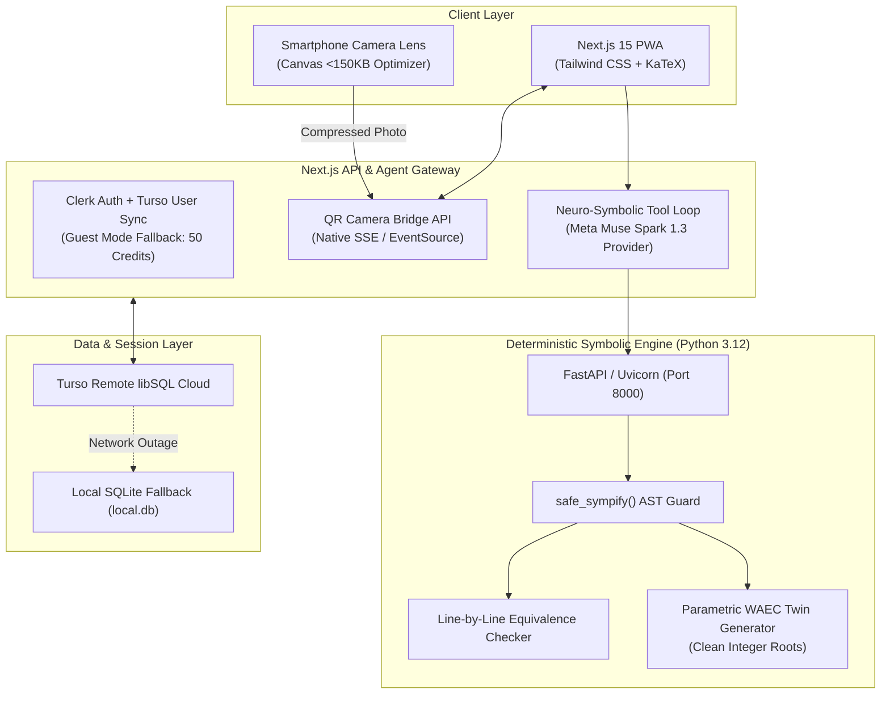

# <div align="center"><h1>📐 SolvAm (SolveAm)</h1><h3>Zero-Hallucination Neuro-Symbolic Math Tutor & "Red-Pen" WAEC Diagnostic Grader</h3><p><em>Built for Meta Hackathon 2026 — Track 1: Build for Your World (Indie Developer)</em></p></div>

<div align="center">

[](https://nextjs.org/)
[](https://turbo.build/)
[](https://fastapi.tiangolo.com/)
[](https://turso.tech/)
[](https://clerk.com/)

</div>

---

## 📌 Executive Summary & Problem Statement

Over **729,429 students fail WASSCE / SSCE mathematics annually in West Africa**. Conventional LLM-based solvers hallucinate intermediate algebra, skip crucial steps, and provide final numbers without method breakdowns.

**SolvAm** addresses this with a **Neuro-Symbolic architecture**:
1. **Zero-Hallucination Equivalence:** Multimodal vision interfaces with a deterministic Python `SymPy` Computer Algebra System (CAS) to verify every step via Algebraic Syntax Tree (AST) evaluation.
2. **Official WAEC Marking Rubrics:** Explanations and diagnostics are scored using **Method Marks (`M1`)** and **Accuracy Marks (`A1`)**, teaching students how examiners award partial credit.
3. **"Red-Pen" Handwritten Mistake Pinpointing:** Students solve problems on real paper, capture an image, and SolvAm diagnoses line-by-line equivalence breaks (e.g. *Sign Error on Step 2*).
4. **Real-time Mobile-to-Desktop QR Bridge:** Scan a QR code from any smartphone to pair the phone camera with the desktop workspace in real-time using Native Server-Sent Events (SSE).
5. **High-Resilience Offline Fallback:** Gracefully degrades across Turso cloud $\rightarrow$ local SQLite (`file:local.db`), Meta API $\rightarrow$ local SymPy, and bundled KaTeX CSS.

---

## 🏗️ System Architecture



---

## 📂 Repository Structure

```text
SolveAm/
├── apps/
│   └── web/                         # Next.js 15 App Router Frontend & API Gateway
│       ├── src/
│       │   ├── app/                 # Routes: /, /capture, /api/*
│       │   ├── components/          # CameraBridgeModal, MathDisplay, TelemetryHud
│       │   └── lib/                 # auth.ts, db.ts, symbolicClient.ts, ai/*
│       ├── .env.example             # Documented environment template
│       └── package.json
├── packages/
│   └── shared-types/                # Shared TypeScript contracts & schemas
├── services/
│   └── symbolic-engine/             # Python FastAPI + SymPy CAS microservice
│       ├── main.py                  # API endpoints (/symbolic/solve, /verify-steps, /generate-twin)
│       ├── math_engine.py           # SymPy AST verification logic
│       ├── schemas.py               # Pydantic schemas
│       └── requirements.txt
├── turbo.json                       # Turborepo pipeline orchestration
├── package.json                     # Root monorepo configuration
└── README.md
```

---

## ⚙️ Prerequisites

Ensure the following runtimes are installed on your machine:

* **Node.js:** `v18.18+` or `v20+`
* **npm:** `v10+`
* **Python:** `3.10` to `3.12`
* **Git**

---

## 🚀 Step-by-Step Replication & Setup Guide

### 1. Clone the Repository

```bash
git clone https://github.com/your-username/SolveAm.git
cd SolveAm
```

### 2. Install Root & Monorepo Dependencies

```bash
npm install
```

### 3. Setup Python Deterministic Symbolic Engine

Navigate to the symbolic engine service and create an isolated virtual environment:

#### Windows (PowerShell):
```powershell
cd services/symbolic-engine
python -m venv venv
.\venv\Scripts\Activate.ps1
pip install -r requirements.txt
cd ../..
```

#### macOS / Linux:
```bash
cd services/symbolic-engine
python3 -m venv venv
source venv/bin/activate
pip install -r requirements.txt
cd ../..
```

### 4. Configure Environment Variables

Create `apps/web/.env.local` by copying the documented template:

```bash
cp apps/web/.env.example apps/web/.env.local
```

Open `apps/web/.env.local` and configure keys as needed:

```env
# ------------------------------------------------------------------------------
# 1. CLERK AUTHENTICATION (Optional: leave blank for Guest Mode with 50 credits)
# ------------------------------------------------------------------------------
NEXT_PUBLIC_CLERK_PUBLISHABLE_KEY=pk_test_...
CLERK_SECRET_KEY=sk_test_...

# ------------------------------------------------------------------------------
# 2. TURSO DATABASE (Defaults to local SQLite 'file:local.db' if empty or offline)
# ------------------------------------------------------------------------------
TURSO_DATABASE_URL="file:local.db"
TURSO_AUTH_TOKEN=

# ------------------------------------------------------------------------------
# 3. DETERMINISTIC SYMBOLIC ENGINE (FastAPI)
# ------------------------------------------------------------------------------
SYMBOLIC_ENGINE_URL="http://localhost:8000"
NEXT_PUBLIC_SYMBOLIC_ENGINE_URL="http://localhost:8000"

# ------------------------------------------------------------------------------
# 4. META AI MODEL API (Optional: fallback loop runs deterministic local SymPy)
# ------------------------------------------------------------------------------
META_API_KEY=
META_API_URL="https://api.meta.ai/v1/chat/completions"
```

> [!NOTE]
> **Offline & Zero-Key Resilient:** SolvAm executes out-of-the-box even with empty keys! It will automatically use local SQLite (`local.db`), guest student sessions (50 free credits), bundled KaTeX CSS, and local SymPy AST solving.

---

## 🏃 Running the Application

SolvAm requires two concurrent services: the **Python CAS service** and the **Next.js Web Gateway**.

### Terminal 1: Start Python Symbolic Engine (Port 8000)

```bash
npm run dev:symbolic
```
*Health check runs at: `http://localhost:8000/health`*

### Terminal 2: Start Next.js Frontend via Turborepo (Port 3000)

```bash
npm run dev
```
*Web client boots on `http://localhost:3000` (listening on `0.0.0.0:3000` for mobile LAN access).*

---

## 📱 Mobile QR Camera Pairing in Local Development

1. Open `http://localhost:3000` on your desktop browser.
2. Ensure your smartphone and laptop are connected to the **same Wi-Fi network or hotspot**.
3. Click **"Scan with Phone (QR)"** in the top navigation.
4. SolvAm automatically detects your laptop's local LAN IPv4 address (e.g., `http://192.168.x.x:3000/capture?session=...`) and encodes it in the QR code.
5. Point your phone camera at the QR code, snap your handwritten problem, and watch it beam to your desktop in real-time via Server-Sent Events (SSE).

---

## 🧪 Verification & Production Build

To verify build pipelines and type contracts across all workspaces:

```bash
npm run build
```

This triggers Turborepo:
1. Compiles `@solvam/shared-types` via `tsc`.
2. Generates an optimized Next.js 15 production build for `@solvam/web`.

---

## 🛡️ Production Safeguards Implemented

* **Deterministic CAS Guard:** Input expressions run through an AST whitelist filter preventing code execution or unsafe SymPy evaluations.
* **Auto Offline Failover:** The database client catches remote network dropouts and automatically falls back to local SQLite without crashing user sessions.
* **Non-Blocking Auth:** Validates Clerk key formats before mounting `<ClerkProvider>` to prevent server-side hydration panics in dev/offline mode.
* **Server-Verified Credits:** SolvAm deducts credits on the server *after* a successful calculation, returning atomic balances to the client.
